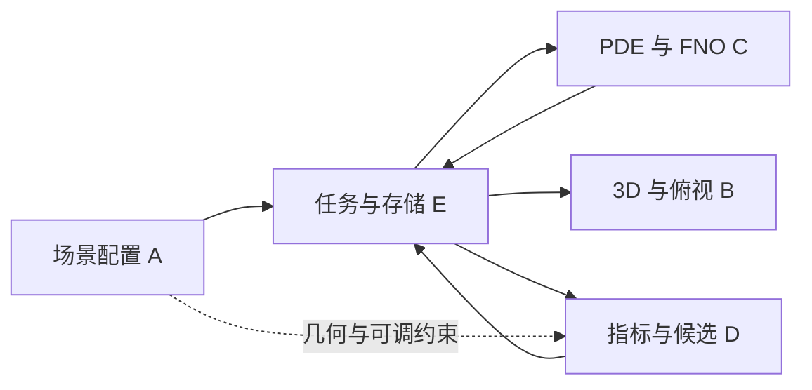

# ADR 0001 模块划分与候选技术

状态：提议，待 W1 全员评审。

2026-11-25 更新：下文 PDE/FNO 为原技术候选；用户已确认改为 STDDN 个体路线，相关计算分工由 [ADR 0002](0002-stddn-trajectory-and-passage.md) 替代。Web/API 框架仍待评审。

## 背景

V5 要求五人四周完成 3D 主视图与 PDE 连续场闭环，且 FNO 实验不能阻断演示。当前建立模块目录和数据契约，不安装未经团队确定的产品框架。

## 建议

采用单仓库，先按模块解耦，默认只部署一个前端和一个后端；C/D 作为可独立调用的算法包。通过任务和版本化结果传递耗时计算，先不引入分布式微服务。

- Web 候选：React + TypeScript；3D 库由 B 评估 Three.js 或其 React 封装，A/B 共用坐标约定。
- API 候选：Python + FastAPI；E 提供存储、任务和统一调用，C/D 无须实现 Web 框架。
- 算法候选：NumPy PDE；FNO 的 PyTorch 等依赖由 C 调研后确定，允许与 API 隔离环境。
- 存储候选：SQLite + 文件；网格结果较大时评估 NPZ 等数组文件和清单，不能一开始就承诺 JSON 可承载全部真实输出。

这些候选来自概念说明或仓库建议，不是已接受决策。PDE 方程、FNO 架构、3D 库和存储格式均未选定。

## 逻辑依赖

这是职责与数据流图，尚无对应运行服务。A/B 可在同一个 Web 应用中协作。

## 取舍

单仓库减少五人跨仓联调和版本漂移；算法包独立便于基准实验。代价是共享变更需要严格评审。先用小型 JSON 样例明确语义，真实场存储在首周确认，避免前端直接绑定模型内部张量。

## 接受条件

各负责人给出最小原型、运行环境和对接证明；明确三维坐标映射、PDE 输入表达、大数组传输和部署方式。记录评审参与人、决定日期及拒绝其他方案的理由后，才能改为“已接受”。
